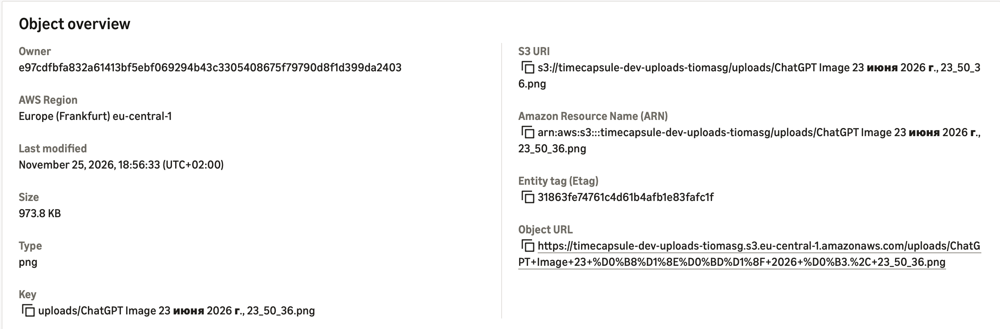
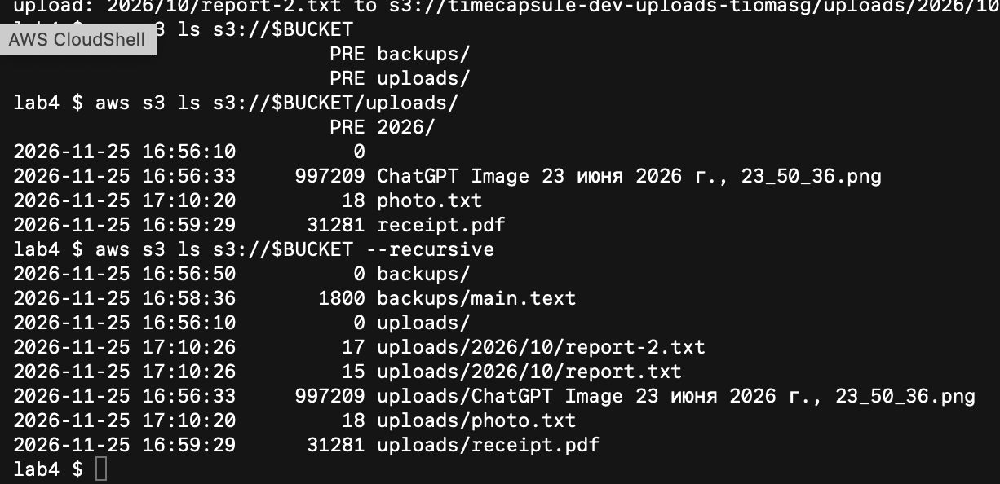
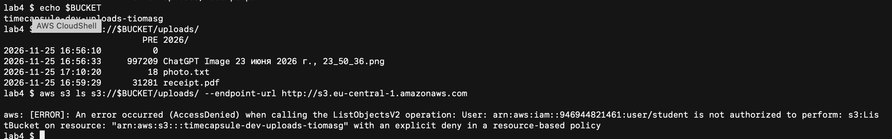
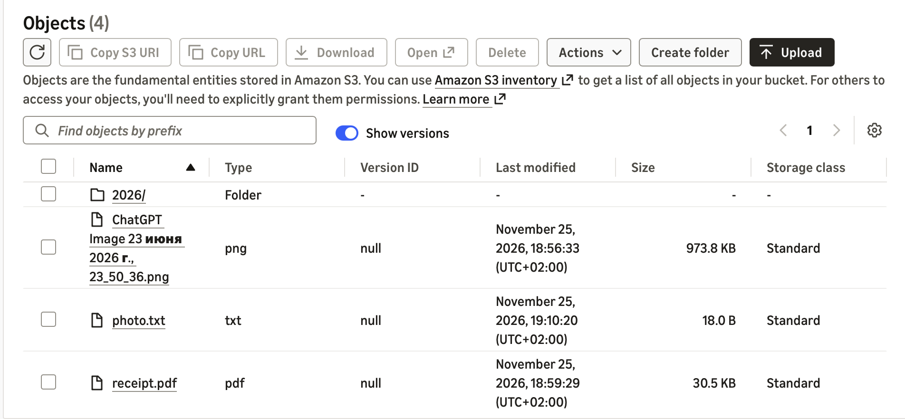
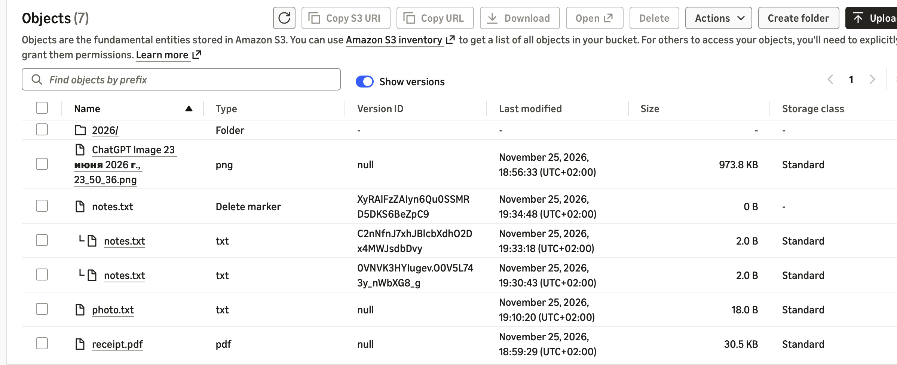
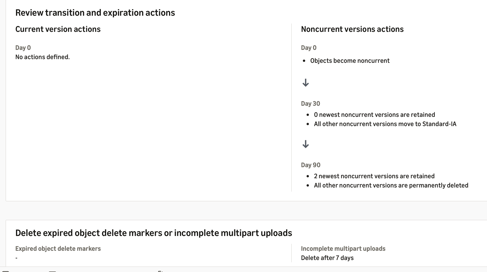
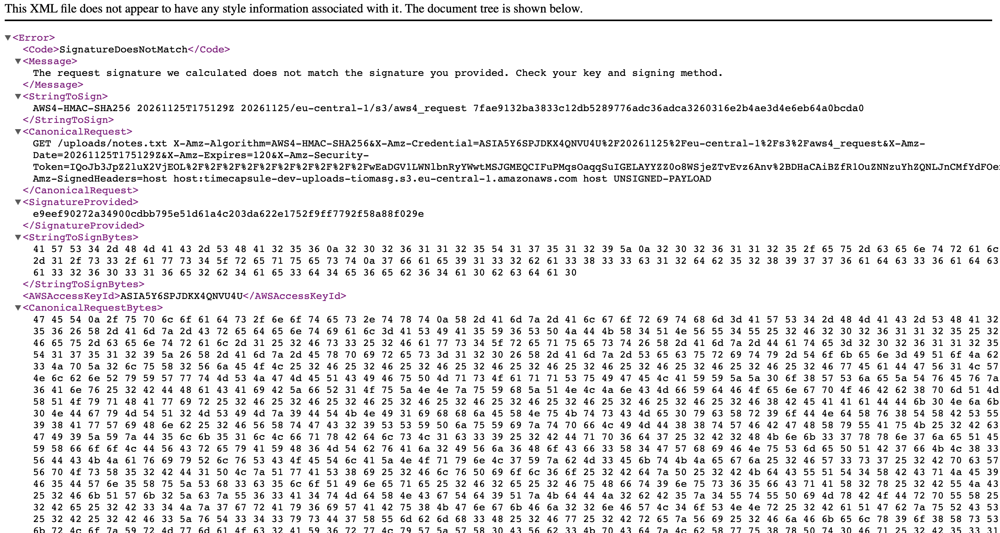
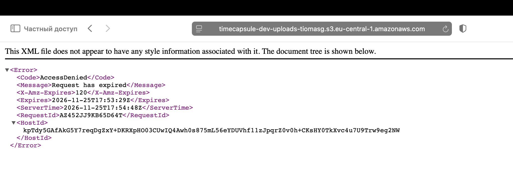
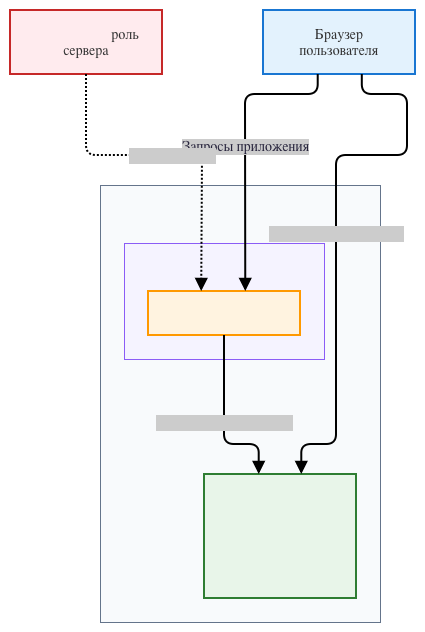

# Лабораторная работа №4 — Amazon S3

**ФИО:** Артем Сигал   
**Группа:** IA2403 
**Специальность:** informatica aplicata  
**Регион:** eu-central-1 (Frankfurt)

## 1. Базовый уровень

### Задание 1. Бакет и объекты в консоли

Создание приватного бакета `timecapsule-dev-uploads-<nickname>` с SSE-S3, отключёнными ACL и включённым Block Public Access. В `uploads/` размещаются изображение и PDF, в `backups/` — текстовый файл.

**Какой ключ у картинки?** Ключ представляет собой полное имя объекта внутри бакета, включая префикс. В данном случае это `uploads/[имя изображения]` (указать фактический ключ).

**Почему Object URL не открывается?** Бакет приватный, а обычный переход по URL не содержит AWS-аутентификации. Даже владелец бакета получает отказ при анонимном запросе.

**Что создала кнопка Create folder?** S3 использует плоское пространство ключей, а не настоящие каталоги. Кнопка создаёт объект нулевого размера с ключом, заканчивающимся на `/`.

### Задание 2. Объекты из командной строки

Создание текстовых файлов в CloudShell, загрузка через `aws s3 cp` и `aws s3 sync`, просмотр объектов, получение метаданных, скачивание `photo.txt` и удаление `report-2.txt`.

**Почему обычный ls показывает PRE, а recursive — полные ключи?** Обычный вывод группирует объекты по общим префиксам, обозначаемым `PRE`. Параметр `--recursive` выводит полные ключи без такой группировки.

**Какой Content-Type получил report.txt?** Ожидаемое значение — `text/plain`. AWS CLI автоматически определяет MIME-тип по расширению файла; фактическое значение подтверждается выводом `head-object`.

### Задание 3. Политика бакета: только HTTPS

Политика запрещает действия `s3:*` с бакетом и его объектами при `aws:SecureTransport = false`. Проверка выполняется обычным HTTPS-запросом и запросом с HTTP endpoint.

**Почему HTTP-запрос получает AccessDenied даже у администратора?** Явный запрет `Deny` имеет приоритет над разрешением `Allow`. Поэтому административные права не позволяют обойти запрет на HTTP.

**Почему Block Public Access не препятствует сохранению политики с Principal: *?** Политика распространяет запрет на всех участников, но не предоставляет публичных разрешений. Поэтому она не противоречит блокировке публичного доступа.

### Задание 4. Версионирование и защита от удаления

Включение Bucket Versioning, загрузка двух версий `notes.txt` с содержимым `v1` и `v2`, создание маркера удаления, восстановление и откат к первой версии. Объекты, загруженные до включения версионирования, имеют Version ID `null`.

**Чем отличается обычное удаление от удаления конкретной версии?** Обычное удаление создаёт Delete marker и скрывает объект, сохраняя данные. Удаление с указанием Version ID окончательно удаляет выбранную версию.

**Какое удаление можно отменить?** Обычное удаление можно отменить, удалив маркер. Окончательное удаление версии средствами версионирования S3 отменить нельзя.

**Какой способ защищает от случайного удаления и какой нужно запрещать приложению?** Версионирование позволяет восстановить объект после обычного удаления. Приложению можно разрешить `s3:DeleteObject`, но необходимо запретить `s3:DeleteObjectVersion`, чтобы оно не могло уничтожать версии окончательно.

### Задание 5. Правило жизненного цикла

Правило `timecapsule-dev-noncurrent` действует только на `uploads/`. Неактуальные версии переходят в Standard-IA через 30 дней, удаляются через 90 дней с сохранением двух самых новых неактуальных версий; незавершённые multipart-загрузки прерываются через 7 дней.

**Как правило действует при десяти перезаписях за неделю?** Если первоначальную версию перезаписали десять раз, получится 11 версий: одна текущая и десять неактуальных. Каждая неактуальная версия достаточного размера становится пригодной для перехода в Standard-IA через 30 дней после утраты актуальности. Через 90 дней после утраты актуальности восемь старейших версий становятся пригодными для удаления, а две новейшие неактуальные и текущая сохраняются, если новых записей нет. Выполнение действий S3 может происходить с задержкой.

**Почему маленькие тестовые файлы не попадут в Standard-IA?** По умолчанию новые правила Lifecycle не переводят объекты размером менее 128 KiB в другие классы хранения. Текстовые файлы занимают всего несколько байтов, но правило удаления старых версий на них продолжает действовать.

**Что такое незавершённая загрузка частями и почему за неё приходится платить?** Multipart Upload позволяет загружать объект отдельными частями. Если загрузка не завершена, уже загруженные части занимают оплачиваемое пространство до завершения или отмены загрузки. Правило автоматически прерывает такие загрузки через семь дней.

### Задание 6. Подписанные URL

Создание подписанной ссылки на изображение на 5 минут через консоль и на `uploads/photo.txt` на 120 секунд через CLI. Проверяется доступ по исходной ссылке, изменение ключа на `notes.txt` и истечение срока действия.

**Какие ошибки вернул S3?** Ожидаемая ошибка при изменении ключа до истечения срока — `SignatureDoesNotMatch`. После истечения срока ожидается `AccessDenied` с сообщением `Request has expired`. Фактические ответы необходимо сверить со скриншотами.

**Почему нельзя получить другой файл, изменив ключ?** Подпись учитывает ключ объекта, HTTP-метод и параметры запроса, включая срок действия. При изменении ключа подпись перестаёт соответствовать запросу, и S3 отклоняет его.

**Обращалась ли команда aws s3 presign к S3 при создании ссылки?** Нет, подпись вычисляется локально с использованием AWS-учётных данных. Существование объекта и разрешения на получение проверяются при использовании ссылки.

## 3. Архитектура — задание 14

Бакет S3 располагается вне VPC внутри региона eu-central-1. Сервер `app-server` использует IAM-роль для операций с вложениями, а браузер скачивает файлы напрямую из S3 по подписанному URL.

Архитектурное решение: [ADR-0003 — Хранение вложений пользователей](0003-attachment-storage.md).

## 4. Дополнительные контрольные вопросы

**1. Как проходит запрос на скачивание вложения и где проверяются права?** Браузер обращается к приложению, которое проверяет аутентификацию пользователя и его право на конкретное вложение. Приложение формирует подписанный URL с помощью временных учётных данных IAM-роли сервера и передаёт его браузеру. Браузер отправляет GET-запрос непосредственно в S3, где проверяются подпись, срок действия и разрешения подписавшей роли.

**2. Какие настройки не дают постороннему открыть вложение по прямому адресу?** Block Public Access, отключённые ACL и отсутствие публичных разрешений обеспечивают приватность бакета, а политика HTTPS запрещает незащищённые запросы. Подписанный URL привязан к конкретному ключу и операции и ограничен сроком действия, который также не может превышать срок действия подписавших временных учётных данных. Любой обладатель действующей ссылки может воспользоваться ею, поэтому её нельзя публиковать.

**3. Почему приложение использует подписанный URL вместо публичного бакета?** Подписанный URL позволяет предоставлять ограниченный по времени доступ к конкретному объекту после проверки прав пользователя приложением. Публичный бакет не обеспечивает такой проверки, а прямая загрузка из S3 по подписанной ссылке дополнительно снижает нагрузку на сервер приложения.

**4. Как изменится схема при необходимости пережить отказ региона eu-central-1?** Необходимо добавить бакет S3 в другом регионе, включить версионирование обоих бакетов и настроить Cross-Region Replication с соответствующей IAM-ролью. Для уже существующих объектов потребуется отдельная репликация, а приложение должно поддерживать переключение на резервный бакет и создание ссылок для него. Репликация асинхронна, поэтому необходимо учитывать возможную потерю последних изменений и предусмотреть восстановление остальных компонентов приложения в другом регионе.

## Заключение

В работе рассматривается использование Amazon S3 для приватного хранения вложений, управление доступом, версионирование, жизненный цикл объектов и временный доступ через подписанные URL. Выбранная архитектура позволяет отделить хранение файлов от сервера приложения и подготовить систему к горизонтальному масштабированию.